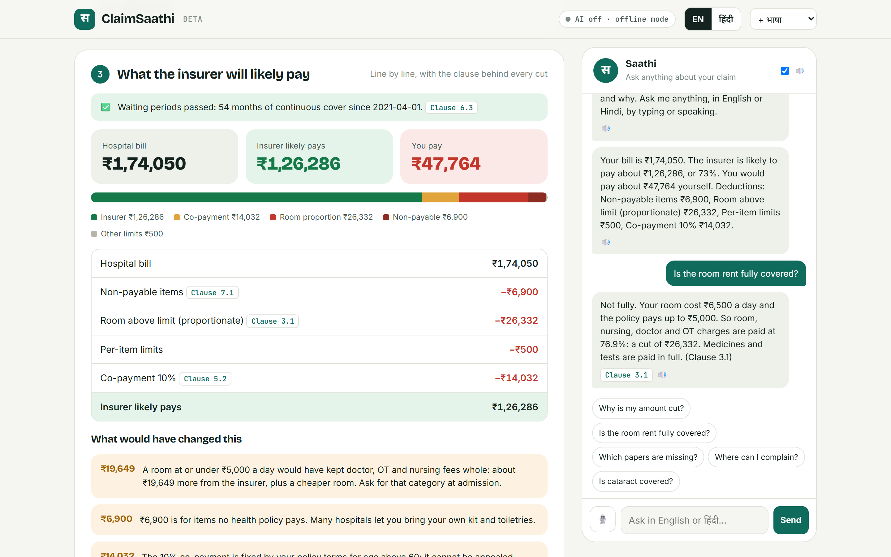
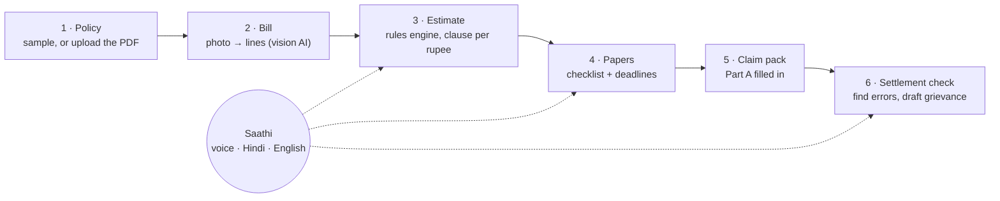
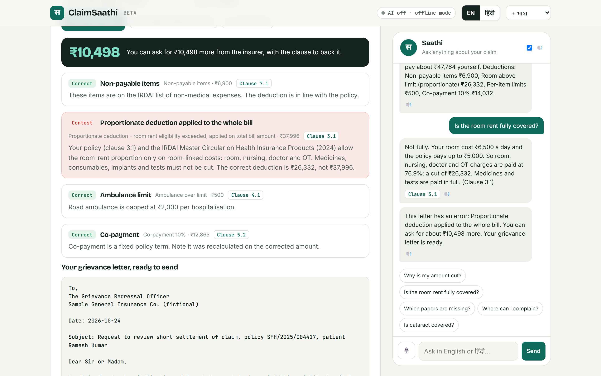
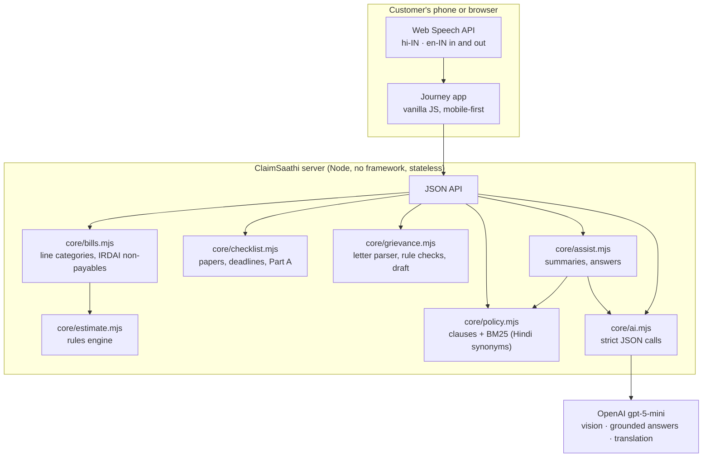

# ClaimSaathi

**Know what your health insurer will pay before you file.**

A family is at the hospital billing desk with a ₹1,74,050 bill. ClaimSaathi ("claim companion") reads the itemised bill, checks every line against their policy and IRDAI's rules, and tells them in Hindi or English: the insurer will likely pay ₹1,26,286, here is every rupee that will be cut, and here is the clause behind each cut. It lists the papers still missing, fills in the claim form, and when the insurer later pays only ₹1,15,789, it reads the settlement letter, finds the deduction that breaks the rules, and drafts the grievance for the ₹10,498 difference.

Built by **Paras Adlakha** and **Harshita Adlakha** for the **Paytm Build for India AI Hackathon, Bengaluru**, Track 2: AI-Powered Financial Journeys.

**▶ [Try it in your browser](https://parasadlakha.github.io/claimsaathi/app/)**: the full app running on GitHub Pages with the sample claim, in English and Hindi, no setup needed. · [Project page](https://parasadlakha.github.io/claimsaathi/) · **🎬 [Narrated 2-minute demo](docs/video/ClaimSaathi-demo-2min.mp4)** · [3-minute pitch video](docs/video/ClaimSaathi-pitch-3min.mp4)

**📑 Hackathon pitch deck:** [PDF](docs/slides/ClaimSaathi-pitch-deck.pdf) · [PowerPoint](docs/slides/ClaimSaathi-pitch-deck.pptx) (the nine slides we submitted for Stage 1: title, problem, solution, product, tech stack, USP, impact, business model, team)



*The estimate for the sample claim: what the insurer will likely pay, every deduction with its policy clause, what would have changed the outcome, and Saathi answering "Is the room rent fully covered?" with the family's own numbers.*

**Contents:** [The hackathon](#the-hackathon) · [The problem](#the-problem) · [What ClaimSaathi does](#what-claimsaathi-does) · [Architecture](#architecture) · [The rules engine](#the-rules-engine) · [Where AI is used](#where-ai-is-used) · [Run it yourself](#run-it-yourself) · [Repository layout](#repository-layout) · [What we learned](#what-we-learned) · [Limitations and roadmap](#limitations-and-roadmap) · [Team](#team) · [References](#references)

---

## The hackathon

| | |
|---|---|
| **Event** | Paytm Build for India AI Hackathon, Bengaluru edition ([Luma page](https://luma.com/6afp5q46)) |
| **Organisers** | Paytm, with devSemble |
| **Stage 1** | Pitch deck on the hackathon platform by **11:59 PM IST, 27 October 2026** |
| **Stage 2** | Finals for shortlisted teams at the Paytm office, Bengaluru, **Saturday 31 October 2026**, 9:30 AM to 7:00 PM |
| **Our track** | Track 2, AI-Powered Financial Journeys: "Make Insurance, Lending and Fintech simpler, faster and more human" |

### What the brief asks for, and where it is in ClaimSaathi

| Brief | ClaimSaathi |
|---|---|
| Reimagine a customer-facing journey in insurance | The health claim, from the billing desk to the grievance, is one guided journey in six steps |
| Remove friction | One photo of the bill instead of reading a 40-page wording; claim form Part A filled in from data already known |
| Reduce complexity | Every deduction explained in one sentence with its clause; a waterfall from bill to payout |
| Faster | The payout estimate is ready before discharge; the papers checklist stops claims being held for missing documents |
| More human | Voice in and out, Hindi and English offline, eight more Indian languages with AI; advice phrased for a worried family, not an underwriter |
| Greater confidence | The money maths is deterministic and cites a clause for every rupee; the model never decides an amount |

The Stage 1 deck covers the seven required sections: title, problem statement, proposed solution, technology stack, USP, impact and benefits, and business model, plus a product slide and a team slide.

---

## The problem

Health insurance in India pays most claims, but the part it does not pay lands on families as a surprise.

- Insurers **rejected or disallowed health claims worth ₹26,037 crore in FY24**, up 19.1% from ₹21,861 crore the year before. Of ₹1.17 lakh crore claimed, 71% was paid ([IRDAI Annual Report 2023-24](https://www.business-standard.com/finance/personal-finance/health-insurance-claims-rejection-up-19-10-in-fy24-irdai-report-124122700754_1.html), via a [Lok Sabha reply](https://moneylife.in/article/health-insurance-claims-worth-rs2603765-crore-rejected-by-insurers-in-fy2324-govt/76282.html)).
- **₹15,100 crore (12.9%) was disallowed**: refused for anomalies or missing information rather than rejected on merit ([Outlook Business](https://www.outlookbusiness.com/economy-and-policy/health-insurers-disallowed-claims-worth-rs-15100-crore-during-fy24)).
- **43% of policyholders** who claimed in the last three years faced hurdles getting paid ([LocalCircles, 2024](https://www.businesstoday.in/personal-finance/insurance/story/health-insurance-43-of-policyholders-faced-struggles-to-get-claims-after-treatment-states-survey-428046-2024-05-02)).
- **Health insurance complaints to the Insurance Ombudsman rose 21.7% to 31,490** in FY24, while life and general complaints fell ([Outlook Money](https://www.outlookmoney.com/insurance/these-5-insurers-recorded-most-policyholder-complaints-in-fy24-report)).
- **3.26 crore health claims** were filed in FY24; the average paid was **₹31,086** ([Outlook Business](https://www.outlookbusiness.com/economy-and-policy/health-insurers-disallowed-claims-worth-rs-15100-crore-during-fy24)).

The rules that cause the gap are knowable in advance; families just meet them too late:

| Rule | What it does to a bill | In the sample claim |
|---|---|---|
| **Room-rent limit** (often 1% of sum insured a day) | If the room costs more, room, nursing, doctor and OT charges are all paid in the same proportion | ₹6,500 room vs ₹5,000 limit: 23% off ₹1,14,100 of fees, **₹26,332** |
| **Non-payable items** (IRDAI list) | Admission kits, gloves, registration, attendant food are never paid | **₹6,900** |
| **Co-payment** | A share of every claim, often for age 60+ or non-network hospitals | 10%: **₹14,032** |
| **Per-item caps and sub-limits** | Ambulance, ICU, cataract, knee replacement | **₹500** |
| **Waiting periods** | Pre-existing and listed diseases are excluded for 2 to 3 years | Passed (54 months of cover) |

And when the insurer gets it wrong, contesting means knowing the 2024 IRDAI Master Circular. The circular limits the proportionate deduction to room-linked costs: it may not be applied to medicines, consumables, implants or diagnostics.

---

## What ClaimSaathi does



| Step | What happens | Sample claim |
|---|---|---|
| **Policy** | The numbers that decide a claim, each tied to its clause: sum insured, room limit, co-pay, waiting periods. Upload your own PDF and ClaimSaathi splits it into clauses and reads the key terms | Suraksha Family Health (fictional), ₹5 lakh, room 1% of SI |
| **Bill** | A photo of the itemised final bill; a vision model reads each line; the engine sorts lines the way insurers do | 16 lines, ₹1,74,050 |
| **Estimate** | Line-by-line payable amount, a waterfall from bill to payout, eligibility checks, and what would have changed the outcome | Insurer likely pays **₹1,26,286**; a room within limit would have meant **₹19,649** more |
| **Papers** | The documents still missing and the dates that matter: intimation, submission, post-hospitalisation cover | 5 of 9 ready; submit by 16 Nov 2025 |
| **Claim pack** | Claim form Part A pre-filled from the policy and the bill, ready to print and sign | |
| **Settlement check** | Paste or photograph the insurer's letter. Each deduction is checked: correct, ask for details, or contest. Contested amounts are quantified and a grievance letter is drafted with the escalation path | Insurer paid ₹1,15,789; proportionate cut applied to the whole bill; **₹10,498 recoverable** |
| **Saathi** | A chat panel that answers in Hindi or English, by text or voice, with the family's own numbers and the clause. Reads answers aloud | "कमरे का किराया पूरा मिलेगा?" |



*The settlement check: three deductions are correct, one is not. ClaimSaathi shows why, how much, and drafts the letter to the insurer's Grievance Redressal Officer.*

---

## Architecture



**Why it is built this way**

- **AI reads and talks; rules do the money.** A claim amount has to be exact and auditable. The model turns a photo into lines and a clause into a sentence; the deterministic engine decides every rupee and cites the clause. The same bill always gives the same answer, which is what makes it testable.
- **Stateless.** The browser holds the policy and the bill and sends them with each request. The server stores nothing about the patient.
- **Works offline.** Without an API key, the sample policy and bill, the full estimate, the checklist, the letter check, and Hindi and English answers from the best-matching clause all work. The header chip shows whether AI is on.
- **The customer never sees a decision.** Every screen says it is an estimate; the insurer or TPA decides.

---

## The rules engine

`core/estimate.mjs` turns a policy and a bill into an estimate. The order matters, and follows how claims are settled:

| # | Step | Rule | Code |
|---|---|---|---|
| 1 | **Eligibility** | Policy period; 30-day initial wait (except accidents); 24-month list of specific diseases; 36-month pre-existing wait | `eligibility()` |
| 2 | **Categories** | Each line is room, nursing, ICU, doctor, procedure, pharmacy, consumables, implants, diagnostics, ambulance, non-payable or other | `classify()` in `core/bills.mjs` |
| 3 | **Non-payables** | Comfort items, items subsumed into room or procedure charges, admin fees, attendant costs: paid at zero, with the reason | `NONPAYABLE_REASON` |
| 4 | **Room proportion** | If the room rate exceeds the limit, room, nursing, doctor and procedure lines are paid at limit ÷ actual. Pharmacy, consumables, implants, diagnostics and ICU are not touched | `ASSOCIATED` |
| 5 | **Caps** | ICU per day, ambulance per admission | |
| 6 | **Sub-limits** | Procedure caps such as cataract per eye | |
| 7 | **Co-payment** | Age and non-network co-pays, on the admissible amount | |
| 8 | **Sum insured** | Payable never exceeds what is left | |

Every line comes back with `payable`, `cut`, a bilingual `reason` and a `clause`. The tips are computed, not written: for the sample claim, a room at the limit would have kept ₹21,832 of fees whole, worth ₹19,649 after co-pay.

`core/grievance.mjs` parses "Less: … Rs 12,345" lines from a settlement letter and runs each through rules: the proportionate cut applied to the whole bill (contest, with the corrected amount), non-payables above what the bill supports (ask for the item list), correct deductions (explained), and missing documents (fixable, not a rejection). The escalation ladder is the insurer's Grievance Redressal Officer, then [Bima Bharosa](https://bimabharosa.irdai.gov.in), then the [Insurance Ombudsman](https://www.cioins.co.in) (free, claims up to ₹50 lakh, within a year of the insurer's reply).

---

## Where AI is used

| Use | Model call | Without a key |
|---|---|---|
| **Read a bill photo** | Vision, strict JSON schema: hospital, patient, dates, diagnosis, every line as printed. Unreadable photos are refused, not guessed | Sample bill |
| **Read a letter photo** | Vision transcription | Paste the text |
| **Answer questions** | BM25 retrieves the top clauses; the model answers in at most three sentences from those clauses and the claim facts, citing clause numbers, in the customer's language | Best clause, plus exact answers for room rent and co-pay from the estimate |
| **Speak more languages** | Translation of the summary into Kannada, Tamil, Telugu, Marathi, Bengali, Gujarati, Malayalam or Punjabi | English and Hindi |

All calls use `gpt-5-mini` with minimal reasoning and are metered (`/api/status`). A claim needs one vision read and a few answers, which costs well under a rupee; the estimate itself never calls a model.

---

## Run it yourself

**Requirements:** Node 22 or newer. Optional: an OpenAI API key.

```bash
git clone https://github.com/ParasAdlakha/claimsaathi.git
cd claimsaathi
npm install
npm test          # 13 tests on the money logic, no keys needed
npm start         # http://localhost:8795
```

Open `http://localhost:8795`, click **Try with a sample claim**, then in step 6 click **Use sample settlement letter** and **Check this letter**. `http://localhost:8795/?demo=1` loads the sample claim straight away.

**Browser-only build:** `npm run pages` copies the app, the engine and the sample data into `docs/app/`, where the same request handlers run in the page instead of on a server. That is what GitHub Pages serves.

**Turn AI on:** `cp .env.example .env.local`, set `OPENAI_API_KEY`, restart. Bill and letter photos, grounded answers and eight more languages switch on. Voice input works in Chrome and Edge.

---

## Repository layout

```
core/
  bills.mjs        Line categories, IRDAI non-payable reasons, input clean-up
  estimate.mjs     The rules engine: eligibility, proportion, caps, sub-limits, co-pay
  checklist.mjs    Papers, deadlines and claim form Part A
  grievance.mjs    Settlement letter parser, deduction checks, grievance letter, escalation
  policy.mjs       Clause splitting, BM25 search with Hindi/Hinglish synonyms, term extraction
  assist.mjs       Spoken summaries and answers (AI, or clause match offline)
  handlers.mjs     The API's request handlers, shared by the server and the browser build
  ai.mjs           OpenAI calls: bill and letter vision, answers, translation
  config.mjs       Every setting in one place
server/server.mjs  node:http server: static pages and the JSON API
scripts/           build-pages.mjs builds docs/app; static-api.mjs runs the handlers in the browser
public/            The journey app: index.html, app.js, style.css
data/sample/       Fictional policy, bill and settlement letter, clearly labelled
docs/              Project page (GitHub Pages), browser app, screenshots, demo bill, slides, video
test/              node --test
```

---

## What we learned

- **The proportionate deduction is where the money is.** It is the largest cut on most bills with a room above the limit, it is invisible on the bill, and it is the deduction insurers most often apply too widely. Encoding the 2024 rule exactly (room-linked costs only) is what lets ClaimSaathi catch the error.
- **Let the model read, not count.** Asking a model "how much will I get?" gives a different plausible number each time. A rules engine plus a model that only reads and explains gave us answers we could unit-test.
- **Hindi questions need Hindi retrieval.** Customers ask "कमरे का किराया" or "kamra kiraya", and the policy says "room rent". A small synonym map in front of BM25 fixed retrieval without any model call.
- **Offline matters for a demo and for trust.** Making every step work without a key forced the money logic to stand on its own.

---

## Limitations and roadmap

**Limitations today**
- One sample policy wording; uploaded wordings are split into clauses and a few key terms are read with patterns, and anything not found keeps typical values (the app says which).
- The non-payable list is a representative subset of IRDAI's lists, matched by keyword.
- Pre- and post-hospitalisation bills, multiple admissions and family floater balances are not modelled yet.
- Estimates have not yet been validated against settled claims.

**Roadmap**
- Pre-admission mode: compare room categories and see out-of-pocket before choosing.
- Cashless desk mode for the one-hour authorisation and three-hour discharge windows.
- Policy wordings for the top retail health plans, parsed into structured terms.
- Validate estimates against settled claims with a TPA partner.
- Inside Paytm: the policy, KYC and bank details pre-filled; medical EMI offered for the gap.

---

## Team

| | Background | Role on ClaimSaathi |
|---|---|---|
| **Paras Adlakha** | Aerospace, electronics, systems engineering | Rules engine, bill reader, app |
| **Harshita Adlakha** | System dynamics, socio-technical systems | Claim journey, IRDAI rules, grievance path, research |

---

## References

- IRDAI Annual Report 2023-24 figures: [Business Standard](https://www.business-standard.com/finance/personal-finance/health-insurance-claims-rejection-up-19-10-in-fy24-irdai-report-124122700754_1.html), [Moneylife (Lok Sabha reply)](https://moneylife.in/article/health-insurance-claims-worth-rs2603765-crore-rejected-by-insurers-in-fy2324-govt/76282.html), [Outlook Business](https://www.outlookbusiness.com/economy-and-policy/health-insurers-disallowed-claims-worth-rs-15100-crore-during-fy24).
- LocalCircles survey, May 2024: [Business Today](https://www.businesstoday.in/personal-finance/insurance/story/health-insurance-43-of-policyholders-faced-struggles-to-get-claims-after-treatment-states-survey-428046-2024-05-02).
- Council for Insurance Ombudsmen, FY24: [Outlook Money](https://www.outlookmoney.com/insurance/these-5-insurers-recorded-most-policyholder-complaints-in-fy24-report).
- IRDAI Master Circular on Health Insurance Products, May 2024 (cashless within 1 hour, discharge within 3 hours): [Business World](https://businessworld.in/article/cashless-claims-within-an-hour-discharge-from-hospital-in-3-hrs-irdai-521477). Proportionate deduction limited to room-linked costs: [Outlook Money](https://www.outlookmoney.com/spotlight/financehub/the-three-lines-in-your-health-policy-that-decide-how-much-you-actually-get-paid), [Ditto](https://www.joinditto.in/articles/health-insurance/proportionate-deduction-in-health-insurance/).
- IRDAI list of non-payable items (IRDAI/HLT/REG/CIR/176/09/2019): [insurer copy](https://rahejaqbe.com/uploads/images/health-claim/pdf/List_of_Non_payable_Items_Health_Products.pdf).
- NITI Aayog, *Health Insurance for India's Missing Middle*, 2021: [PDF](https://www.niti.gov.in/sites/default/files/2021-10/HealthInsurance-forIndiasMissingMiddle_28-10-2021.pdf).
- Paytm Insurance Broking licence renewal, February 2026: [Business Today](https://www.businesstoday.in/markets/stocks/story/paytm-shares-in-focus-irdai-renews-insurance-broking-license-of-subsidiary-515509-2026-02-10).

Several figures come from news reports of IRDAI and CIO reports rather than the reports themselves; check the primary documents before quoting them in a decision.

---

*ClaimSaathi is a hackathon prototype. Its estimates are not claim decisions and not advice; the insurer or TPA decides every claim. The sample policy, insurer, hospital and patient are fictional.*
